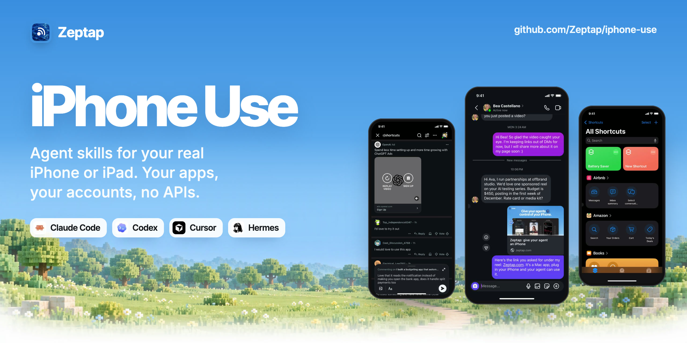
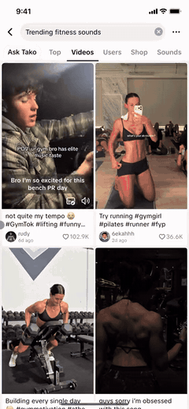
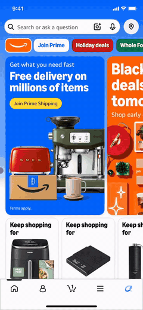

<p align="center">
  <a href="https://zeptap.com/?utm_source=gh"></a>
</p>

<h3 align="center">Your AI agent can now use your iPhone or iPad.</h3>

<p align="center">
  37 open skills that teach Claude Code, Codex, Cursor, Hermes, OpenClaw or any MCP agent to do real jobs on your real iPhone or iPad.<br>
  Your apps, your logged-in accounts, no APIs to connect. Up to 5 devices at once.
</p>

<p align="center">
  <a href="https://zeptap.com/?utm_source=gh"><b>zeptap.com</b></a> ·
  <a href="https://zeptap.com/skills?utm_source=gh">Browse all skills</a> ·
  <a href="https://zeptap.com/docs">Docs</a> ·
  <a href="https://github.com/Zeptap/releases/releases/latest/download/Zeptap.dmg">Download for Mac</a>
</p>

<p align="center">
  
  
  
  
  
  
  
</p>

---

## Why your iPhone

Your life already runs on your phone and tablet. Your Instagram, TikTok and Reddit, your DMs, your delivery and travel apps, your notes, the app you're building. Most of it has no API, or an API that won't let an agent do the real thing.

**Zeptap** is a Mac app that connects your iPhone or iPad to your agent. Plug it in and your agent sees the screen, opens apps, taps, scrolls and types, inside the accounts you're already logged into. These skills give it the know-how for specific jobs, from warming up a new TikTok to testing your app's sign-up flow.

- **A real iPhone or iPad.** Not a simulator, not an emulator, not a cloud phone.
- **Up to 5 devices at once.** Run several iPhones and iPads side by side from one Mac.
- **No setup pain.** No Xcode, no developer account, nothing installed on the device. About two minutes.
- **Any agent.** Claude Code, Codex, Cursor, Hermes, OpenClaw or any MCP client, on the plan you already pay for.
- **Your accounts.** It works in the apps you already use, as you.

## See it run

Real recordings from a real iPhone, sped up. Tap one to open its page.

<table>
<tr><td align="center"><a href="https://zeptap.com/skills/tiktok-warmup?utm_source=gh"></a><br><sub><b>TikTok warm-up</b></sub></td><td align="center"><a href="https://zeptap.com/skills/reddit-karma-builder?utm_source=gh"></a><br><sub><b>Reddit karma builder</b></sub></td><td align="center"><a href="https://zeptap.com/skills/instagram-comment-to-dm?utm_source=gh"></a><br><sub><b>Comment to DM</b></sub></td></tr>
<tr><td align="center"><a href="https://zeptap.com/skills/short-video-cross-poster?utm_source=gh"></a><br><sub><b>Cross-poster</b></sub></td><td align="center"><a href="https://zeptap.com/skills/ios-real-device-testing?utm_source=gh"></a><br><sub><b>Real iPhone testing</b></sub></td><td align="center"><a href="https://zeptap.com/skills/iphone-shortcuts-builder?utm_source=gh"></a><br><sub><b>Shortcuts builder</b></sub></td></tr>
</table>

## Quick start

**1. Get Zeptap and plug in your iPhone or iPad.** [Download for Mac](https://github.com/Zeptap/releases/releases/latest/download/Zeptap.dmg), open it and connect your device with a cable. ([Setup guide](https://zeptap.com/docs/get-started/setup?utm_source=gh))

**2. Add the skills to your agent.**

```bash
# every skill
npx skills add zeptap/iphone-use

# or just one
npx skills add zeptap/iphone-use --skill reddit-karma-builder
npx skills add zeptap/iphone-use --skill ipad-use
```

In Claude Code you can also add this repo as a plugin marketplace:

```
/plugin marketplace add Zeptap/iphone-use
/plugin install iphone-use@iphone-use
```

**3. Ask in plain words.**

```
Warm up my new TikTok for my budgeting app
Find people on Reddit asking for a tool like mine
Open Goodnotes on my iPad and export today's notes as a PDF
```

## Skills

Every skill is a plain `SKILL.md` your agent reads. Each one asks a few setup questions the first time, then does the job the same careful way every run. Tap a skill's name for its page on [zeptap.com/skills](https://zeptap.com/skills?utm_source=gh), or the id below it for the file.

### 🌱 Warm up and grow

New accounts, quiet accounts and accounts that need to show up every day, warmed up and grown like a real person would. [See them on zeptap.com ↗](https://zeptap.com/skills/grow?utm_source=gh)

| Skill | What it does |
|---|---|
| <a href="https://zeptap.com/skills/instagram-warmup?utm_source=gh"></a><br>**[Instagram warm-up](https://zeptap.com/skills/instagram-warmup?utm_source=gh)**<br><sub>[`instagram-warmup`](skills/instagram-warmup/SKILL.md)</sub> | Automates the Instagram warm-up for a new or dormant account over about 7 days. One short session a day watches niche Reels, then slowly adds likes, follows, saves and comments, set up for your target country, language and time zone. Tells you when to post your first Reel and whether the account is healthy. |
| <a href="https://zeptap.com/skills/tiktok-warmup?utm_source=gh"></a><br>**[TikTok warm-up](https://zeptap.com/skills/tiktok-warmup?utm_source=gh)**<br><sub>[`tiktok-warmup`](skills/tiktok-warmup/SKILL.md)</sub> | Warms up a new TikTok account in about 5 days so the For You page learns your niche. Daily sessions watch niche videos to the end, then add search, likes, follows and a few real comments for your target country and language. Ends with the 700-view health test before you post. |
| <a href="https://zeptap.com/skills/reddit-karma-builder?utm_source=gh"></a><br>**[Reddit karma builder](https://zeptap.com/skills/reddit-karma-builder?utm_source=gh)**<br><sub>[`reddit-karma-builder`](skills/reddit-karma-builder/SKILL.md)</sub> | Builds Reddit karma and trust on a new account, or several, with a phased karma ladder. Helpful comments in subreddits picked from your niche, each sub's rules read first, daily caps and shadowban checks, until the account can post and mention your product. |
| <a href="https://zeptap.com/skills/niche-engagement?utm_source=gh"></a><br>**[Niche engagement](https://zeptap.com/skills/niche-engagement?utm_source=gh)**<br><sub>[`niche-engagement`](skills/niche-engagement/SKILL.md)</sub> | Daily Instagram and TikTok engagement in your niche. Finds fresh posts from the right creators, likes and saves the good ones and leaves comments you approve, within daily caps, so the people you want to reach notice your account. |
| <a href="https://zeptap.com/skills/linkedin-engagement?utm_source=gh"></a><br>**[LinkedIn engagement](https://zeptap.com/skills/linkedin-engagement?utm_source=gh)**<br><sub>[`linkedin-engagement`](skills/linkedin-engagement/SKILL.md)</sub> | LinkedIn engagement from your own profile. Tell it the titles, companies and people you want to reach, and it finds their fresh posts, reacts and leaves 2 to 5 thoughtful comments a day in your voice, each one approved by you. |

### 🔎 Research

Read Instagram, TikTok, Reddit and the App Store like an analyst. Hooks, rivals, Reddit threads, buyers and what people complain about. [See them on zeptap.com ↗](https://zeptap.com/skills/research?utm_source=gh)

| Skill | What it does |
|---|---|
| <a href="https://zeptap.com/skills/competitor-content-check?utm_source=gh"></a><br>**[Competitor content check](https://zeptap.com/skills/competitor-content-check?utm_source=gh)**<br><sub>[`competitor-content-check`](skills/competitor-content-check/SKILL.md)</sub> | Social media competitor analysis for Instagram Reels and TikTok. Ranks each rival's latest posts by views, breaks down the hook, format, length, audio and call to action, and saves a swipe file of what to copy. |
| <a href="https://zeptap.com/skills/ad-creative-scout?utm_source=gh"></a><br>**[Ad creative scout](https://zeptap.com/skills/ad-creative-scout?utm_source=gh)**<br><sub>[`ad-creative-scout`](skills/ad-creative-scout/SKILL.md)</sub> | An ad spy tool for the Instagram ads your buyers actually see. Primes your account like a buyer in your niche, collects sponsored Reels, Stories and feed ads with their hook, offer and call to action, and turns the winners into 3 static ad concepts. |
| <a href="https://zeptap.com/skills/reddit-research?utm_source=gh"></a><br>**[Reddit research](https://zeptap.com/skills/reddit-research?utm_source=gh)**<br><sub>[`reddit-research`](skills/reddit-research/SKILL.md)</sub> | Reddit research from the last 30 days, read in the signed-in app. Searches your question several ways, reads the busiest threads and returns what people want, verbatim quotes, tools they praise and hate, and live threads worth answering. |
| <a href="https://zeptap.com/skills/reddit-lead-finder?utm_source=gh"></a><br>**[Reddit lead finder](https://zeptap.com/skills/reddit-lead-finder?utm_source=gh)**<br><sub>[`reddit-lead-finder`](skills/reddit-lead-finder/SKILL.md)</sub> | Reddit lead generation from your own account. Finds people asking right now for a product like yours, scores each thread for buying intent, flags threads that also rank on Google, and drafts a reply that helps first and mentions your product second, disclosed. |
| <a href="https://zeptap.com/skills/weekly-creator-report?utm_source=gh"></a><br>**[Weekly creator report](https://zeptap.com/skills/weekly-creator-report?utm_source=gh)**<br><sub>[`weekly-creator-report`](skills/weekly-creator-report/SKILL.md)</sub> | TikTok analytics and Instagram insights in one weekly report. Reads TikTok Studio and Instagram's professional dashboard on your own accounts and writes up the numbers, your best post, why it worked and what to post next. |
| <a href="https://zeptap.com/skills/content-gap-finder?utm_source=gh"></a><br>**[Content gap finder](https://zeptap.com/skills/content-gap-finder?utm_source=gh)**<br><sub>[`content-gap-finder`](skills/content-gap-finder/SKILL.md)</sub> | Finds a video topic with proven demand and weak supply. Reads how people describe a problem on Reddit, checks what TikTok and Instagram show for those exact words, and returns the gap, a format to copy and three hooks. |
| <a href="https://zeptap.com/skills/hook-and-format-scout?utm_source=gh"></a><br>**[Hook and format scout](https://zeptap.com/skills/hook-and-format-scout?utm_source=gh)**<br><sub>[`hook-and-format-scout`](skills/hook-and-format-scout/SKILL.md)</sub> | Finds the hooks and formats winning in your niche this week on TikTok and Instagram. Reads the top posts' opening lines, formats, sounds and view counts, then writes a hook for your own product. |
| <a href="https://zeptap.com/skills/content-ideas-from-comments?utm_source=gh"></a><br>**[Ideas from comments](https://zeptap.com/skills/content-ideas-from-comments?utm_source=gh)**<br><sub>[`content-ideas-from-comments`](skills/content-ideas-from-comments/SKILL.md)</sub> | Turns the comments under viral TikToks and Reels into your next video ideas. Keeps only the real unanswered questions, ranks them and tells you which one to film first. |
| <a href="https://zeptap.com/skills/app-onboarding-teardown?utm_source=gh"></a><br>**[Onboarding teardown](https://zeptap.com/skills/app-onboarding-teardown?utm_source=gh)**<br><sub>[`app-onboarding-teardown`](skills/app-onboarding-teardown/SKILL.md)</sub> | App onboarding and paywall teardown for any iPhone app. Walks from first launch to the paywall screen by screen, with screenshots, and writes up the copy, permission asks, price, free trial, plan layout and dark patterns. |

### 📮 Post everywhere

Instagram, TikTok, YouTube, LinkedIn and Reddit, posted from your own accounts with a caption written for each app. [See them on zeptap.com ↗](https://zeptap.com/skills/post?utm_source=gh)

| Skill | What it does |
|---|---|
| <a href="https://zeptap.com/skills/instagram-poster?utm_source=gh"></a><br>**[Instagram poster](https://zeptap.com/skills/instagram-poster?utm_source=gh)**<br><sub>[`instagram-poster`](skills/instagram-poster/SKILL.md)</sub> | Instagram auto posting for Reels, photos and carousels from your camera roll. Writes the caption and hashtags, adds location, tagged people and cover, then posts or saves a draft once you approve. Works for personal and creator accounts. |
| <a href="https://zeptap.com/skills/instagram-story-poster?utm_source=gh"></a><br>**[Instagram Story link sticker](https://zeptap.com/skills/instagram-story-poster?utm_source=gh)**<br><sub>[`instagram-story-poster`](skills/instagram-story-poster/SKILL.md)</sub> | Posts Instagram Stories with link stickers, polls, question boxes, mentions and location, the stickers Instagram's API can't add. Writes the sticker text and call to action, builds the Story and posts it after your yes. |
| <a href="https://zeptap.com/skills/tiktok-uploader?utm_source=gh"></a><br>**[TikTok uploader](https://zeptap.com/skills/tiktok-uploader?utm_source=gh)**<br><sub>[`tiktok-uploader`](skills/tiktok-uploader/SKILL.md)</sub> | TikTok auto upload from your camera roll with a caption written for TikTok search. Sets hashtags, comments, the AI-generated label and branded content disclosure, then posts publicly or saves to Drafts. |
| <a href="https://zeptap.com/skills/youtube-shorts-uploader?utm_source=gh"></a><br>**[YouTube Shorts uploader](https://zeptap.com/skills/youtube-shorts-uploader?utm_source=gh)**<br><sub>[`youtube-shorts-uploader`](skills/youtube-shorts-uploader/SKILL.md)</sub> | Uploads vertical videos as YouTube Shorts with a search-friendly title, audience and visibility set. No Google Cloud project, OAuth setup or API audit, because the YouTube app is already signed in. |
| <a href="https://zeptap.com/skills/linkedin-poster?utm_source=gh"></a><br>**[LinkedIn poster](https://zeptap.com/skills/linkedin-poster?utm_source=gh)**<br><sub>[`linkedin-poster`](skills/linkedin-poster/SKILL.md)</sub> | A LinkedIn post generator that writes in your voice, with a strong first line, clean line breaks and a few hashtags, then posts or schedules it from your personal profile after your approval. |
| <a href="https://zeptap.com/skills/reddit-poster?utm_source=gh"></a><br>**[Reddit post writer](https://zeptap.com/skills/reddit-poster?utm_source=gh)**<br><sub>[`reddit-poster`](skills/reddit-poster/SKILL.md)</sub> | Writes Reddit posts that fit each subreddit. Reads the rules and top posts, writes the title and body in the sub's style, picks the flair and stops at Post for your yes, so the post stays up. |
| <a href="https://zeptap.com/skills/short-video-cross-poster?utm_source=gh"></a><br>**[Short video cross-poster](https://zeptap.com/skills/short-video-cross-poster?utm_source=gh)**<br><sub>[`short-video-cross-poster`](skills/short-video-cross-poster/SKILL.md)</sub> | Cross-posts one vertical video to TikTok, Instagram Reels and YouTube Shorts, plus LinkedIn if you want, each with its own native caption and settings. Drafts first, one approval before anything goes public. |
| <a href="https://zeptap.com/skills/multi-account-poster?utm_source=gh"></a><br>**[Multi-account poster](https://zeptap.com/skills/multi-account-poster?utm_source=gh)**<br><sub>[`multi-account-poster`](skills/multi-account-poster/SKILL.md)</sub> | Posts to several Instagram and TikTok accounts without mixing them up, switching accounts in the app or across up to 5 iPhones on one Mac. A caption adapted to each account and an approval per account. Built for agencies, brands and creators. |

### 💬 Replies and DMs

DMs, comments and brand deals, answered in your voice. [See them on zeptap.com ↗](https://zeptap.com/skills/inbox?utm_source=gh)

| Skill | What it does |
|---|---|
| <a href="https://zeptap.com/skills/comment-replies?utm_source=gh"></a><br>**[Comment replies](https://zeptap.com/skills/comment-replies?utm_source=gh)**<br><sub>[`comment-replies`](skills/comment-replies/SKILL.md)</sub> | Replies to comments on your Instagram Reels and YouTube videos in your own voice. Reads the unanswered comments, skips spam, drafts replies as one batch for approval and posts each under the right comment. |
| <a href="https://zeptap.com/skills/instagram-dm-replies?utm_source=gh"></a><br>**[Instagram DM replies](https://zeptap.com/skills/instagram-dm-replies?utm_source=gh)**<br><sub>[`instagram-dm-replies`](skills/instagram-dm-replies/SKILL.md)</sub> | Instagram DM automation for personal and creator accounts. Sorts unread chats and message requests into buyers, brand deals, complaints, fans and spam, drafts replies from your facts and sends only what you approve. |
| <a href="https://zeptap.com/skills/instagram-comment-to-dm?utm_source=gh"></a><br>**[Comment to DM](https://zeptap.com/skills/instagram-comment-to-dm?utm_source=gh)**<br><sub>[`instagram-comment-to-dm`](skills/instagram-comment-to-dm/SKILL.md)</sub> | A ManyChat alternative that works on any Instagram account. Sends your link by DM to everyone who commented a keyword like LINK or GUIDE, skips people already messaged and sends in approved batches. |

### 🧪 App testing

Test your iOS app on a real iPhone, the way your users do. No Xcode, no developer account. [See them on zeptap.com ↗](https://zeptap.com/skills/test?utm_source=gh)

| Skill | What it does |
|---|---|
| <a href="https://zeptap.com/skills/ios-real-device-testing?utm_source=gh"></a><br>**[Real iPhone app testing](https://zeptap.com/skills/ios-real-device-testing?utm_source=gh)**<br><sub>[`ios-real-device-testing`](skills/ios-real-device-testing/SKILL.md)</sub> | iOS app testing on a real iPhone, not a simulator, with no Xcode needed. Runs sign-up, onboarding, the paywall, sandbox purchases, push, camera and deep links like a QA tester, and reports each step with a screenshot and the first break. |
| <a href="https://zeptap.com/skills/ios-bug-repro?utm_source=gh"></a><br>**[iPhone bug reproduction](https://zeptap.com/skills/ios-bug-repro?utm_source=gh)**<br><sub>[`ios-bug-repro`](skills/ios-bug-repro/SKILL.md)</sub> | Reproduces bug reports on a real iPhone. Follows the exact steps several times and returns a verdict with screenshots, device model, iOS version and app version, ready to paste into GitHub, Linear or Jira. |
| <a href="https://zeptap.com/skills/ios-dynamic-type-check?utm_source=gh"></a><br>**[Dynamic Type check](https://zeptap.com/skills/ios-dynamic-type-check?utm_source=gh)**<br><sub>[`ios-dynamic-type-check`](skills/ios-dynamic-type-check/SKILL.md)</sub> | Dynamic Type and accessibility text testing on a real iPhone. Raises the text size up to the largest accessibility sizes, walks your key screens, flags clipped or overlapping text and controls pushed off screen, then puts the setting back. |
| <a href="https://zeptap.com/skills/testflight-smoke-test?utm_source=gh"></a><br>**[TestFlight smoke test](https://zeptap.com/skills/testflight-smoke-test?utm_source=gh)**<br><sub>[`testflight-smoke-test`](skills/testflight-smoke-test/SKILL.md)</sub> | TestFlight smoke testing on a real iPhone. Installs the newest build, checks the build number, signs in with a test account, runs the core flow and this build's changes, and calls pass or fail for each step. |
| <a href="https://zeptap.com/skills/app-store-rank-check?utm_source=gh"></a><br>**[App Store keyword rankings](https://zeptap.com/skills/app-store-rank-check?utm_source=gh)**<br><sub>[`app-store-rank-check`](skills/app-store-rank-check/SKILL.md)</sub> | App Store keyword rank tracking from a real iPhone. Searches each keyword in the App Store app, skips the ads, records the top organic apps and your position, and says which keywords you can win. |
| <a href="https://zeptap.com/skills/app-review-digest?utm_source=gh"></a><br>**[App Store review analysis](https://zeptap.com/skills/app-review-digest?utm_source=gh)**<br><sub>[`app-review-digest`](skills/app-review-digest/SKILL.md)</sub> | App Store review analysis for your app or a competitor's. Reads the most critical and most recent reviews, groups complaints into themes with counts and quotes, and ranks what to fix first. |

### ☕ Everyday

Errands, price checks, shortcuts and anything else you do in an app on your iPhone or iPad. [See them on zeptap.com ↗](https://zeptap.com/skills/everyday?utm_source=gh)

| Skill | What it does |
|---|---|
| <a href="https://zeptap.com/skills/iphone-use?utm_source=gh"></a><br>**[iPhone automation](https://zeptap.com/skills/iphone-use?utm_source=gh)**<br><sub>[`iphone-use`](skills/iphone-use/SKILL.md)</sub> | iPhone automation in any app. Your agent opens apps, reads the screen, taps, scrolls and types in your signed-in accounts, then checks the result. The base skill the others build on, for any job in an app with no API. |
| <a href="https://zeptap.com/skills/ipad-use?utm_source=gh"></a><br>**[iPad automation](https://zeptap.com/skills/ipad-use?utm_source=gh)**<br><sub>[`ipad-use`](skills/ipad-use/SKILL.md)</sub> | iPad automation in any app, in your signed-in accounts. Handles what's different on an iPad, from landscape screens, sidebars and columns to the Dock, Split View and the pointer, and runs alongside your iPhones on the same Mac. |
| <a href="https://zeptap.com/skills/iphone-errands?utm_source=gh"></a><br>**[Reorders, rides and carts](https://zeptap.com/skills/iphone-errands?utm_source=gh)**<br><sub>[`iphone-errands`](skills/iphone-errands/SKILL.md)</sub> | Prepares everyday orders in your own apps. Reorders the exact Amazon item you bought before, sets up an airport Uber with the right terminal and time, or rebuilds your usual food order, then stops at the summary so you check and pay. |
| <a href="https://zeptap.com/skills/iphone-shortcuts-builder?utm_source=gh"></a><br>**[iPhone Shortcuts builder](https://zeptap.com/skills/iphone-shortcuts-builder?utm_source=gh)**<br><sub>[`iphone-shortcuts-builder`](skills/iphone-shortcuts-builder/SKILL.md)</sub> | Builds any Apple Shortcut from one sentence. Adds the actions in the Shortcuts app, links each output to the next, sets Share Sheet input, names it and tests it in the app where you'll use it. |
| <a href="https://zeptap.com/skills/delivery-price-check?utm_source=gh"></a><br>**[Uber Eats vs DoorDash](https://zeptap.com/skills/delivery-price-check?utm_source=gh)**<br><sub>[`delivery-price-check`](skills/delivery-price-check/SKILL.md)</sub> | Compares the same food order on Uber Eats, DoorDash and any other delivery app you have. Reads item price, fees, member discounts and arrival time at checkout for your account and address, and says where to order. |
| <a href="https://zeptap.com/skills/flight-price-check?utm_source=gh"></a><br>**[Flight price checker](https://zeptap.com/skills/flight-price-check?utm_source=gh)**<br><sub>[`flight-price-check`](skills/flight-price-check/SKILL.md)</sub> | Flight price comparison across the travel apps you choose, like Skyscanner, Google Flights, Kayak or Hopper. Reads the cheapest fares and any price prediction, then says book now, wait or move your dates. Stops before booking. |

<sub>The `instagram`, `tiktok` and `reddit` folders are app guides. They hold the shared rules and screen notes that the job skills above load first.</sub>

## How it works

<p align="center"></p>

1. **Zeptap runs on your Mac** and shows your agent the iPhone or iPad screen, with tools to tap, swipe, type and open apps.
2. **A skill tells the agent how to do one job well.** Which screens to expect, what to check, when to stop and what to report.
3. **You stay in charge.** You watch every tap on your Mac. Skills that post or send follow the mode you pick on the first run.

## FAQ

<details><summary><b>Can an AI agent control my iPhone or iPad?</b></summary><br>
Yes. With Zeptap on your Mac, Claude Code, Codex, Cursor and other agents see your real device's screen and open apps, tap, scroll and type in the accounts you're signed into, including apps that have no API.
</details>

<details><summary><b>Do I need Xcode or an Apple developer account?</b></summary><br>
No. Zeptap is a Mac app. Plug in your iPhone or iPad and it works, with nothing installed on the device.
</details>

<details><summary><b>Does it work on iPad?</b></summary><br>
Yes. The <a href="https://zeptap.com/skills/ipad-use?utm_source=gh">iPad automation</a> skill lets your agent use any app on your iPad, handling landscape screens, sidebars, the Dock and Split View. iPhones and iPads can be connected to the same Mac at once.
</details>

<details><summary><b>How many devices can I run at once?</b></summary><br>
Up to 5 iPhones or iPads on one Mac. Each skill call names the device it runs on, so jobs on different devices never mix.
</details>

<details><summary><b>Which agents work with these skills?</b></summary><br>
Claude Code, Claude Desktop, Codex, Cursor, Hermes, OpenClaw and any MCP client. Skills install with <code>npx skills add zeptap/iphone-use</code>.
</details>

<details><summary><b>Is it a cloud phone or an emulator?</b></summary><br>
Neither. It's your own iPhone or iPad on your desk, with your real apps and logged-in accounts.
</details>

<details><summary><b>Can I use the skills without Zeptap?</b></summary><br>
Every skill has a "Without Zeptap" path. Your agent still gives you the plan, the checklist or the drafts, and tells you how to connect a device to do the job for real.
</details>

<details><summary><b>Will warm-ups or Reddit skills get my account banned?</b></summary><br>
Nothing can promise that, so the skills are built to act like a careful person. Phases with daily caps, spacing between actions, each subreddit's rules read first, shadowban checks, disclosed product mentions only, and never vote manipulation.
</details>

<details><summary><b>How much does Zeptap cost?</b></summary><br>
The skills are free and open. Zeptap itself is pay once, use it for life. See <a href="https://zeptap.com/pricing?utm_source=gh">pricing</a>.
</details>

## About Zeptap

[Zeptap](https://zeptap.com/?utm_source=gh) lets AI agents use your iPhone or iPad, just like you do. Agents already browse the web and use computers. Your phone is where you live, so that's where your agent should be able to work too.

**[Download for Mac](https://github.com/Zeptap/releases/releases/latest/download/Zeptap.dmg)** · **[zeptap.com](https://zeptap.com/?utm_source=gh)** · **[All skills](https://zeptap.com/skills?utm_source=gh)** · **[Docs](https://zeptap.com/docs)**

## Contributing

New skills, fixes and screen notes for app updates are welcome. See [CONTRIBUTING.md](CONTRIBUTING.md). Run `python3 scripts/check_skills.py` before you open a pull request.

## License

[MIT](LICENSE) for everything in this repo. Zeptap the app is a separate product.
