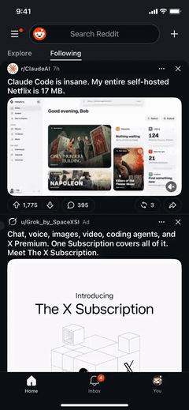
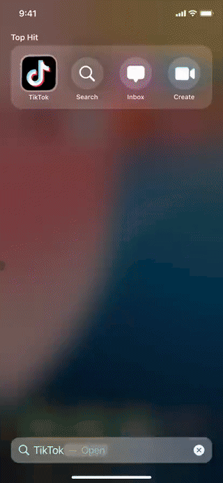
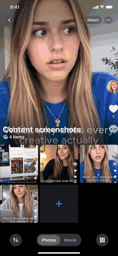
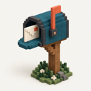
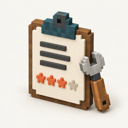

<p align="center">
  <a href="https://zeptap.com/?utm_source=gh"></a>
</p>

<h3 align="center">Your AI agent can now use your iPhone.</h3>

<p align="center">
  Skills that teach Claude Code, Codex, Cursor, Hermes or any MCP agent to do real jobs on your real iPhone.<br>
  Your apps, your logged-in accounts, no APIs to connect.
</p>

<p align="center">
  <a href="https://zeptap.com/?utm_source=gh"><b>zeptap.com</b></a> ·
  <a href="https://zeptap.com/iphone-use?utm_source=gh">Browse skills</a> ·
  <a href="https://zeptap.com/docs?utm_source=gh">Docs</a> ·
  <a href="https://github.com/Zeptap/releases/releases/latest/download/Zeptap.dmg">Download for Mac</a>
</p>

<p align="center">
  
  
  
  
  
  
</p>

---

## Why your iPhone

Your life already runs on your phone. Your Instagram, TikTok and Reddit, your DMs, your banking, delivery and travel apps, the app you're building. Most of it has no API, or an API that won't let an agent do the real thing.

**Zeptap** is a Mac app that connects your iPhone to your agent. Plug the phone in and your agent sees the screen, opens apps, taps, scrolls and types, inside the accounts you're already logged into. These skills give it the know-how for specific jobs, from warming up a new TikTok to testing your app's sign-up flow.

- **A real iPhone.** Not a simulator, not a cloud phone.
- **No setup pain.** No Xcode, no developer account, nothing installed on the phone. About two minutes.
- **Any agent.** Claude Code, Codex, Cursor, Hermes, OpenClaw or any MCP client.
- **Your accounts.** It works in the apps you already use, as you.

## See it run

Real recordings from a real iPhone, sped up.

<table>
<tr><td align="center"><br><sub><b>TikTok warm-up</b></sub></td><td align="center"><br><sub><b>Reddit karma builder</b></sub></td><td align="center"><br><sub><b>Comment to DM</b></sub></td></tr>
<tr><td align="center"><br><sub><b>Cross-poster</b></sub></td><td align="center"><br><sub><b>Real iPhone testing</b></sub></td><td align="center"><br><sub><b>Shortcuts builder</b></sub></td></tr>
</table>

## Quick start

**1. Get Zeptap and plug in your iPhone.** [Download for Mac](https://github.com/Zeptap/releases/releases/latest/download/Zeptap.dmg), open it, connect your iPhone with a cable. ([Setup guide](https://zeptap.com/docs/get-started/setup?utm_source=gh))

**2. Add the skills to your agent.**

```bash
# every skill
npx skills add zeptap/iphone-use

# or just one
npx skills add zeptap/iphone-use --skill reddit-karma-builder
```

In Claude Code you can also add this repo as a plugin marketplace:

```
/plugin marketplace add Zeptap/iphone-use
/plugin install iphone-use@iphone-use
```

**3. Ask in plain words.**

```
Warm up my new TikTok for my budgeting app
Find people on Reddit asking for a tool like mine
Test my sign-up flow on my iPhone and tell me what breaks
```

## Skills

Every skill is a plain `SKILL.md` your agent reads. Each one asks a few setup questions the first time, then does the job the same careful way every run.

### 🌱 Warm up and grow

New accounts that act like a real person, so your first posts actually get seen.

|  | Skill | What it does | Try saying |
|---|---|---|---|
|  | **[Instagram warm-up](skills/instagram-warmup/SKILL.md)**<br><sub>[page ↗](https://zeptap.com/iphone-use/instagram-warmup?utm_source=gh)</sub> | Warm up a new Instagram account so your first Reel actually gets seen. | <sub>“Warm up my new Instagram account for home workouts”</sub> |
|  | **[TikTok warm-up](skills/tiktok-warmup/SKILL.md)**<br><sub>[page ↗](https://zeptap.com/iphone-use/tiktok-warmup?utm_source=gh)</sub> | Warm up a new TikTok account so your first video actually gets views. | <sub>“Warm up my new TikTok for my budgeting app”</sub> |
|  | **[Reddit karma builder](skills/reddit-karma-builder/SKILL.md)**<br><sub>[page ↗](https://zeptap.com/iphone-use/reddit-karma-builder?utm_source=gh)</sub> | Build Reddit karma on a new account, one helpful comment at a time. | <sub>“Build karma on my new Reddit account”</sub> |
|  | **[Niche engagement](skills/niche-engagement/SKILL.md)**<br><sub>[page ↗](https://zeptap.com/iphone-use/niche-engagement?utm_source=gh)</sub> | Show up in your niche every day with likes and comments that sound like you. | <sub>“Spend 15 minutes liking and commenting in my niche”</sub> |
|  | **[LinkedIn engagement](skills/linkedin-engagement/SKILL.md)**<br><sub>[page ↗](https://zeptap.com/iphone-use/linkedin-engagement?utm_source=gh)</sub> | Get on the radar of the people you want to reach on LinkedIn. | <sub>“Comment on posts from growth leaders today”</sub> |

### 🔎 Research

Read Reddit, TikTok and Instagram like an analyst. Buyers, hooks, rivals and what people complain about.

|  | Skill | What it does | Try saying |
|---|---|---|---|
|  | **[Competitor content check](skills/competitor-content-check/SKILL.md)**<br><sub>[page ↗](https://zeptap.com/iphone-use/competitor-content-check?utm_source=gh)</sub> | See which posts are winning for your competitors, and why. | <sub>“What's working for Glossier on Instagram right now?”</sub> |
|  | **[Ad creative scout](skills/ad-creative-scout/SKILL.md)**<br><sub>[page ↗](https://zeptap.com/iphone-use/ad-creative-scout?utm_source=gh)</sub> | See the Instagram ads your customers see, and get ideas for your own. | <sub>“What ads are my competitors running?”</sub> |
|  | **[Reddit research](skills/reddit-research/SKILL.md)**<br><sub>[page ↗](https://zeptap.com/iphone-use/reddit-research?utm_source=gh)</sub> | Find out what Reddit really thinks about anything, from the last 30 days. | <sub>“What do founders recommend for cold email?”</sub> |
|  | **[Reddit lead finder](skills/reddit-lead-finder/SKILL.md)**<br><sub>[page ↗](https://zeptap.com/iphone-use/reddit-lead-finder?utm_source=gh)</sub> | Find people on Reddit asking for exactly what you sell, and answer them first. | <sub>“Find people on Reddit asking for a tool like mine”</sub> |
|  | **[Weekly creator report](skills/weekly-creator-report/SKILL.md)**<br><sub>[page ↗](https://zeptap.com/iphone-use/weekly-creator-report?utm_source=gh)</sub> | Your TikTok and Instagram numbers in one weekly note, with what to post next. | <sub>“How did my TikTok do this week?”</sub> |
|  | **[Content gap finder](skills/content-gap-finder/SKILL.md)**<br><sub>[page ↗](https://zeptap.com/iphone-use/content-gap-finder?utm_source=gh)</sub> | Find the video your audience keeps asking for that nobody has made well. | <sub>“What video should I make that nobody has made well?”</sub> |
|  | **[Hook and format scout](skills/hook-and-format-scout/SKILL.md)**<br><sub>[page ↗](https://zeptap.com/iphone-use/hook-and-format-scout?utm_source=gh)</sub> | Fresh hook ideas from the TikToks and Reels winning in your niche right now. | <sub>“What hooks are working for budgeting apps?”</sub> |
|  | **[Ideas from comments](skills/content-ideas-from-comments/SKILL.md)**<br><sub>[page ↗](https://zeptap.com/iphone-use/content-ideas-from-comments?utm_source=gh)</sub> | Turn the questions in viral comments into your next video ideas. | <sub>“Give me video ideas from comments in my niche”</sub> |
|  | **[Onboarding teardown](skills/app-onboarding-teardown/SKILL.md)**<br><sub>[page ↗](https://zeptap.com/iphone-use/app-onboarding-teardown?utm_source=gh)</sub> | See exactly how top apps onboard new users and sell their paywall. | <sub>“Walk me through Duolingo's onboarding”</sub> |

### 📮 Post everywhere

Reels, Stories, TikToks, Shorts, LinkedIn and Reddit posts, with a caption written for each app.

|  | Skill | What it does | Try saying |
|---|---|---|---|
|  | **[Instagram poster](skills/instagram-poster/SKILL.md)**<br><sub>[page ↗](https://zeptap.com/iphone-use/instagram-poster?utm_source=gh)</sub> | Post Reels, photos and carousels to Instagram, caption and all. | <sub>“Post my newest Reel with a caption about Friday's drop”</sub> |
|  | **[Instagram Story link sticker](skills/instagram-story-poster/SKILL.md)**<br><sub>[page ↗](https://zeptap.com/iphone-use/instagram-story-poster?utm_source=gh)</sub> | Instagram Stories with link stickers, polls and questions, posted for you. | <sub>“Post my latest photo to my story with a link to my shop”</sub> |
|  | **[TikTok uploader](skills/tiktok-uploader/SKILL.md)**<br><sub>[page ↗](https://zeptap.com/iphone-use/tiktok-uploader?utm_source=gh)</sub> | Upload to TikTok with a caption people actually search for. | <sub>“Post my newest video to TikTok”</sub> |
|  | **[YouTube Shorts uploader](skills/youtube-shorts-uploader/SKILL.md)**<br><sub>[page ↗](https://zeptap.com/iphone-use/youtube-shorts-uploader?utm_source=gh)</sub> | Turn your vertical videos into YouTube Shorts, titled and published. | <sub>“Upload my newest video as a YouTube Short”</sub> |
|  | **[LinkedIn poster](skills/linkedin-poster/SKILL.md)**<br><sub>[page ↗](https://zeptap.com/iphone-use/linkedin-poster?utm_source=gh)</sub> | Write and post LinkedIn updates that sound like you, or schedule them. | <sub>“Turn my release notes into a LinkedIn post”</sub> |
|  | **[Reddit post writer](skills/reddit-poster/SKILL.md)**<br><sub>[page ↗](https://zeptap.com/iphone-use/reddit-poster?utm_source=gh)</sub> | Write Reddit posts that fit each subreddit's rules, and stay up. | <sub>“Share how I got my first 50 users in r/SideProject”</sub> |
|  | **[Short video cross-poster](skills/short-video-cross-poster/SKILL.md)**<br><sub>[page ↗](https://zeptap.com/iphone-use/short-video-cross-poster?utm_source=gh)</sub> | Post one video to TikTok, Reels and Shorts at once, each with its own caption. | <sub>“Post this video on TikTok, Reels and Shorts”</sub> |
|  | **[Multi-account poster](skills/multi-account-poster/SKILL.md)**<br><sub>[page ↗](https://zeptap.com/iphone-use/multi-account-poster?utm_source=gh)</sub> | Post to all your Instagram and TikTok accounts without mixing them up. | <sub>“Post this Reel on both of my brand accounts”</sub> |

### 💬 Replies and DMs

DMs, comments and brand deals, answered in your voice.

|  | Skill | What it does | Try saying |
|---|---|---|---|
|  | **[Comment replies](skills/comment-replies/SKILL.md)**<br><sub>[page ↗](https://zeptap.com/iphone-use/comment-replies?utm_source=gh)</sub> | Reply to every comment on your Reels and YouTube videos in your own voice. | <sub>“Reply to the comments on my last Reel”</sub> |
|  | **[Instagram DM replies](skills/instagram-dm-replies/SKILL.md)**<br><sub>[page ↗](https://zeptap.com/iphone-use/instagram-dm-replies?utm_source=gh)</sub> | Clear your Instagram DMs, answer buyers and catch every brand deal. | <sub>“Reply to my Instagram DMs from today”</sub> |
|  | **[Comment to DM](skills/instagram-comment-to-dm/SKILL.md)**<br><sub>[page ↗](https://zeptap.com/iphone-use/instagram-comment-to-dm?utm_source=gh)</sub> | Send your link to everyone who comments a keyword, on any Instagram account. | <sub>“Send the link to everyone who commented LINK”</sub> |

### 🧪 App testing

Test your iOS app on a real iPhone. No Xcode, no developer account.

|  | Skill | What it does | Try saying |
|---|---|---|---|
|  | **[Real iPhone app testing](skills/ios-real-device-testing/SKILL.md)**<br><sub>[page ↗](https://zeptap.com/iphone-use/ios-real-device-testing?utm_source=gh)</sub> | Test your app on a real iPhone the way your users do. No Xcode needed. | <sub>“Test my sign-up flow on my iPhone and tell me what breaks”</sub> |
|  | **[iPhone bug reproduction](skills/ios-bug-repro/SKILL.md)**<br><sub>[page ↗](https://zeptap.com/iphone-use/ios-bug-repro?utm_source=gh)</sub> | Reproduce bug reports on a real iPhone and get an answer ready for the ticket. | <sub>“Can you reproduce this bug on my iPhone?”</sub> |
|  | **[Dynamic Type check](skills/ios-dynamic-type-check/SKILL.md)**<br><sub>[page ↗](https://zeptap.com/iphone-use/ios-dynamic-type-check?utm_source=gh)</sub> | See if your app still works when people turn up the text size. | <sub>“Check my app at the largest text size”</sub> |
|  | **[TestFlight smoke test](skills/testflight-smoke-test/SKILL.md)**<br><sub>[page ↗](https://zeptap.com/iphone-use/testflight-smoke-test?utm_source=gh)</sub> | Check every new TestFlight build works before your testers open it. | <sub>“Install the latest TestFlight build and check it works”</sub> |
|  | **[App Store keyword rankings](skills/app-store-rank-check/SKILL.md)**<br><sub>[page ↗](https://zeptap.com/iphone-use/app-store-rank-check?utm_source=gh)</sub> | See where your app really ranks in the App Store for any keyword. | <sub>“Where does my app rank for habit tracker?”</sub> |
|  | **[App Store review analysis](skills/app-review-digest/SKILL.md)**<br><sub>[page ↗](https://zeptap.com/iphone-use/app-review-digest?utm_source=gh)</sub> | Turn App Store reviews into a clear list of what to fix first. | <sub>“What are people complaining about in my app?”</sub> |

### ☕ Everyday

The small jobs you do on your phone every week.

|  | Skill | What it does | Try saying |
|---|---|---|---|
|  | **[iPhone automation](skills/iphone-use/SKILL.md)**<br><sub>[page ↗](https://zeptap.com/iphone-use/iphone-use?utm_source=gh)</sub> | Your AI agent can use any app on your iPhone, just like you do. | <sub>“Turn this TikTok recipe into a shopping list in Notes”</sub> |
|  | **[Reorders, rides and carts](skills/iphone-errands/SKILL.md)**<br><sub>[page ↗](https://zeptap.com/iphone-use/iphone-errands?utm_source=gh)</sub> | Line up your usual Amazon order or airport Uber in seconds. | <sub>“Reorder my usual coffee pods on Amazon”</sub> |
|  | **[iPhone Shortcuts builder](skills/iphone-shortcuts-builder/SKILL.md)**<br><sub>[page ↗](https://zeptap.com/iphone-use/iphone-shortcuts-builder?utm_source=gh)</sub> | Describe the iPhone Shortcut you want and get it built and tested. | <sub>“Make a shortcut that saves any link to my Ideas note”</sub> |
|  | **[Uber Eats vs DoorDash](skills/delivery-price-check/SKILL.md)**<br><sub>[page ↗](https://zeptap.com/iphone-use/delivery-price-check?utm_source=gh)</sub> | Find out if Uber Eats or DoorDash is cheaper for tonight's order. | <sub>“Is a large pepperoni cheaper on Uber Eats or DoorDash?”</sub> |
|  | **[Flight price checker](skills/flight-price-check/SKILL.md)**<br><sub>[page ↗](https://zeptap.com/iphone-use/flight-price-check?utm_source=gh)</sub> | Check flight prices across your favourite travel apps and know whether to book now or wait. | <sub>“Should I book LAX to JFK for Dec 18 now or wait?”</sub> |

<sub>The `instagram`, `tiktok` and `reddit` folders are app guides. They hold the shared rules and screen notes that the job skills above load first.</sub>

## How it works

<p align="center"></p>

1. **Zeptap runs on your Mac** and shows your agent the iPhone screen, with tools to tap, swipe, type and open apps.
2. **A skill tells the agent how to do one job well.** Which screens to expect, what to check, when to stop and what to report.
3. **You stay in charge.** You watch every tap on your Mac. Skills that post or send follow the mode you pick on the first run.

## FAQ

<details><summary><b>Do I need Xcode or an Apple developer account?</b></summary><br>
No. Zeptap is a Mac app. Plug in your iPhone and it works, with nothing installed on the phone.
</details>

<details><summary><b>Which agents work with these skills?</b></summary><br>
Claude Code, Claude Desktop, Codex, Cursor, Hermes, OpenClaw and any MCP client. Skills install with <code>npx skills add zeptap/iphone-use</code>.
</details>

<details><summary><b>Is it a cloud phone or an emulator?</b></summary><br>
Neither. It's your own iPhone on your desk, with your real apps and logged-in accounts. Up to 5 iPhones on one Mac.
</details>

<details><summary><b>Can I use the skills without Zeptap?</b></summary><br>
Every skill has a "Without Zeptap" section. Your agent still gives you the plan, the checklist or the drafts, and tells you how to connect an iPhone to do the job for real.
</details>

<details><summary><b>Will warm-ups or Reddit skills get my account banned?</b></summary><br>
Nothing can promise that, so the skills are built to act like a careful person. Phases with daily caps, spacing between actions, each subreddit's rules read first, shadowban checks, disclosed product mentions only, and never vote manipulation.
</details>

<details><summary><b>How much does Zeptap cost?</b></summary><br>
The skills are free and open. Zeptap itself is pay once, use it for life. See <a href="https://zeptap.com/pricing?utm_source=gh">pricing</a>.
</details>

## About Zeptap

[Zeptap](https://zeptap.com/?utm_source=gh) lets AI agents use your iPhone, just like you do. Agents already browse the web and use computers. The phone is where people live, so that's where your agent should be able to work too.

**[Download for Mac](https://github.com/Zeptap/releases/releases/latest/download/Zeptap.dmg)** · **[zeptap.com](https://zeptap.com/?utm_source=gh)** · **[All skills](https://zeptap.com/iphone-use?utm_source=gh)**

## Contributing

New skills, fixes and screen notes for app updates are welcome. See [CONTRIBUTING.md](CONTRIBUTING.md). Run `python3 scripts/check_skills.py` before you open a pull request.

## License

[MIT](LICENSE) for everything in this repo. Zeptap the app is a separate product.
